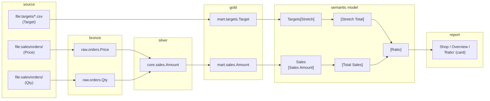

# Data Platform Toolkit

**Ask your AI assistant where a Power BI number comes from, and get the answer down to the source column.**

An MCP (Model Context Protocol) server for Power BI projects saved as PBIP. It reads the files on disk, with no connection to Power BI Desktop, the Power BI service or Microsoft Fabric, and lets an AI assistant:

- **analyse and safely edit semantic models** in TMDL format (read-only by default);
- **find where measures and columns are used** in PBIR reports, and which security roles read them;
- **trace end-to-end lineage**: from the source column of a SQL Server database project, through its medallion layers and Power Query, to the measures and the report visuals.

[](https://github.com/akabyte-labs/data-platform-toolkit/actions/workflows/tests.yml)

Asked where the *Ratio* card of a synthetic test project gets its numbers from, the server follows it back to the files the data warehouse loads ([the full example](docs/lineage.md#example-where-the-number-of-a-visual-comes-from)):



## Try it

```bash
uvx --python 3.13 mcp-data-platform-toolkit --check "C:\path\to\Project.pbip"
```

`--check` validates the project and prints a ready-to-paste configuration for your MCP client. Full setup: [docs/installation.md](docs/installation.md).

## What you can ask

| Ask | What the server does |
| --- | --- |
| "Where is [Total Sales] used, and does any RLS role read it?" | Searches every PBIR report and the RLS filters |
| "Which source columns does [Gross Margin %] come from?" | Follows DAX, Power Query and the T-SQL of the database project, upstream |
| "If I drop mart.sales.Discount, what breaks?" | The same chain, downstream, down to the visuals |
| "Draft the lineage.yaml of this database project." | Reads the project and asks only what the SQL can't tell |

More requests, with the tools behind each one: [docs/tools.md](docs/tools.md#what-you-can-ask).

## How it fits with Microsoft's server

Microsoft's [Power BI Modeling MCP Server](https://github.com/microsoft/powerbi-modeling-mcp) works *inside* the semantic model. This server works *around* it, and answers the questions the model alone can't: which reports and security roles use each field, and where its data comes from.

| | Microsoft's Power BI Modeling MCP Server | Data Platform Toolkit |
|---|---|---|
| **Reads** | the semantic model, from Power BI Desktop, Fabric or a PBIP folder | the PBIP files on disk: semantic model, PBIR reports, and the SQL database project |
| **Answers** | what the model contains, and DAX queries | where each field is used, who can see it, where its data comes from |
| **Edits** | the whole model | measures, calculation items, formats, folders, visibility, descriptions and OLS, written straight into the TMDL files; the rest of the model through the [bridge](docs/tools.md#the-microsoft-bridge) |

You don't have to choose. If the official server is installed, this server's optional [bridge](docs/tools.md#the-microsoft-bridge) gives the assistant its modeling tools on the local PBIP folder, from the same connection. Everything else of the official server, such as DAX queries, refresh and cloud operations, stays with it.

## Documentation

- [Installation and client setup](docs/installation.md)
- [Tools reference](docs/tools.md)
- [End-to-end lineage and lineage.yaml](docs/lineage.md)
- [Configuration and options](docs/configuration.md)
- [Known limitations](docs/limitations.md)
- [Development: project structure and tests](docs/development.md)
- [Changelog](CHANGELOG.md) · [Contributing](CONTRIBUTING.md) · [Code of Conduct](CODE_OF_CONDUCT.md) · [Security](SECURITY.md)

Released under the [MIT License](LICENSE). Not affiliated with or endorsed by Microsoft. Power BI and Microsoft Fabric are trademarks of Microsoft Corporation.
