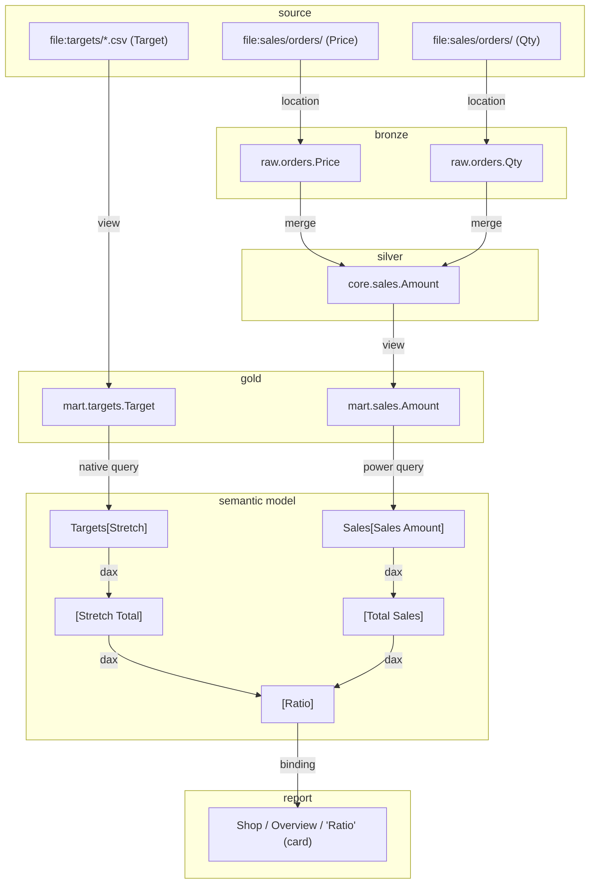

# End-to-end lineage

[Back to the README](../README.md)

- [What the lineage follows](#what-the-lineage-follows)
- [Example: where the number of a visual comes from](#example-where-the-number-of-a-visual-comes-from)
- [Database lineage configuration](#database-lineage-configuration): [no structure yet](#when-the-project-has-no-structure-yet), [writing it](#writing-the-configuration), [drafts](#drafts)
- [Lineage tools](tools.md#lineage)

## What the lineage follows

From a source column to every visual that shows it, and back. In detail:

- **Database project** (`.sqlproj`, T-SQL), column by column:
  - views, `INSERT`, `MERGE`, `UPDATE`, `SELECT INTO`, `CREATE TABLE AS`;
  - stored procedures, temporary tables followed through;
  - files read with `OPENROWSET` and external tables.

  Every object belongs to a medallion layer (bronze, silver, gold or your own). Loads the SQL doesn't show (pipelines, generic procedures) are described as patterns in a `lineage.yaml` file. The server drafts that file from the project and asks you only what the SQL can't answer; a guide, a check tool and rules suggested from the object names help you finish it.
- **Power Query** of each table:
  - navigation to the source table, native queries (parsed against the project's columns) and Direct Lake;
  - renames, computed columns, merges and appends;
  - parameters and query functions.
- **Semantic model**: calculated columns, measures, calculation groups, calculated tables and field parameters (DAX).
- **Reports**: visuals, filters, drillthrough fields, bookmarks and report-level measures of the PBIR reports bound to the model.

The lineage can be exported as a Mermaid diagram, a Markdown page, CSV or JSON. Anything the server can't read (dynamic SQL, a Power Query step it doesn't interpret) is reported with its location, never guessed.

## Example: where the number of a visual comes from

The test suite builds a small synthetic project (`tests/test_end_to_end.py`): a database project with bronze, silver and gold layers, a semantic model and a report. Asked where the *Ratio* card gets its numbers from, the server follows it back to the files the data warehouse loads. This is the `export_lineage` Mermaid output (column level, upstream from `Shop/Overview/Ratio`), as GitHub draws it. The export runs left to right (`flowchart LR`); here the first line is changed to `flowchart TB` so the diagram fits the page:



The assistant reads the same chain as text (`get_end_to_end_lineage` on `[Total Sales]`, upstream; header shortened). Every edge says how it was found, with its file and line:

```text
=== END-TO-END LINEAGE: Shop (column level) ===
Target: [Total Sales], direction upstream
Coverage: 12 of 14 model data columns traced to their source; 5 of 5 visuals reach a column outside the model.

[Total Sales] [semantic model]
   <- Sales[Sales Amount] [semantic model]  dax  definition/tables/_Measures.tmdl:4
      <- mart.sales.Amount [gold]  power query  partition 'Sales': renamed from 'Amount' in 'Renamed Columns'
         <- core.sales.Amount [silver]  view  mart/Views/sales.sql:1
            <- raw.orders.Price [bronze]  merge  core/Stored Procedures/load_sales.sql:12
               <- file:sales/orders/ (Price) [source]  location  raw/Tables/orders.sql:1
            <- raw.orders.Qty [bronze]  merge  core/Stored Procedures/load_sales.sql:12
               <- file:sales/orders/ (Qty) [source]  location  raw/Tables/orders.sql:1
```

## Database lineage configuration

The lineage finds on its own everything the SQL states. A configuration file adds what the SQL can't tell:

- **Layers:** which schemas make up each medallion layer, in flow order.
- **Rules:** loads that no statement in the project shows. Each rule is a regular expression matching the loaded objects plus a template for their source; for example, every `curated.<entity>_history` table is loaded from `curated.<entity>`.
- **Technical columns:** the columns the ETL creates.

The server looks for the configuration in this order:

1. `config_path`, when a tool is given one;
2. the repository's `lineage.yaml` next to the `.sqlproj`, if the team committed one;
3. yours: `projects\<repository>\<database project>.lineage.yaml` in [your folder](configuration.md#your-folder).

Every lineage response says which file it used. Without any, the standard medallion applies: schemas `bronze`, `silver` and `gold`.

### When the project has no structure yet

A warehouse whose schemas are called `stg`, `etl`, `dwh`, `pbi`… has no objects in the standard layers, so its lineage would show almost nothing. Instead of carrying on silently, `get_sql_project_lineage`, `get_end_to_end_lineage` and `export_lineage` step in when a project has no configuration (or an empty one) and the standard layers place less than half of its objects:

1. They infer the structure from the SQL, as `draft_lineage_config` does: the layer of each schema in flow order (with `project_path`, the schemas the model reads become the last layer), the schemas to leave out, rules for the loads the SQL doesn't show, and the columns the ETL creates.
2. They **show it to you in a client form** (MCP elicitation, the same mechanism used for [your folder](configuration.md#your-folder)), together with the file it would be saved to, and offer three choices: **save** it as yours, **change** it (you say what, and the assistant redraws it with you), or **not now**.
3. The file is written only on **save**, in [your folder](configuration.md#your-folder) outside the repository, as `projects\<repository>\<database project>.lineage.yaml`. Your answer reaches the server without going through the language model, so saving works in read-only mode too. The repository's own `lineage.yaml` is never replaced.

Some details:

- A client that can't show forms receives the structure through the assistant, once.
- With **not now**, or if you cancel the form, the structure is used for the current session only, and every response says `PROVISIONAL, not saved`.
- An existing but empty file of yours is replaced on **save**; its comments are kept at the end.
- `test_lineage_config` and `suggest_lineage_rules` always read the files as they are.

### Files written by a pipeline

A pipeline often writes files that a warehouse view then reads: for example a Parquet file exported from `etl.vw_fact_x` and read by `dwh.fact_x` through `OPENROWSET`. The SQL doesn't show who writes the file, so the lineage would stop there.

When another object in the project has a name matching the view, `test_lineage_config` flags it, and both `suggest_lineage_rules` and the inferred structure above include a rule that connects them (`dwh\.fact_(?P<name>\w+)` from `etl.vw_fact_{name}`). A file that people drop by hand (a CSV of targets, say) has no such object and is treated as a source.

### Writing the configuration

The quickest way is to ask the assistant:

1. `draft_lineage_config` reads the project and proposes every section: the layer of each schema (based on its name, the flows between schemas and, with `project_path`, what the model reads), the schemas to ignore, rules for the tables nothing loads, and the ETL columns.
2. The assistant asks you the questions the SQL can't settle, each with a proposed answer, and drafts again with your answers until nothing is left open.
3. `save_lineage_config` (full access) saves the file in your folder, or next to the `.sqlproj` if you ask to share it with the team (`scope='repo'`). See [Drafts](#drafts) below. In read-only mode, paste the draft into the file that `--lineage-config` opens.
4. Run `test_lineage_config` to see what the file still doesn't describe. Add `project_path` to check the Power BI side as well.

You can also open the configuration in the system's editor with `--lineage-config`, which creates a draft when there is none ([details](configuration.md#lineage-configuration)):

```bash
uvx --python 3.13 mcp-data-platform-toolkit --lineage-config "C:\path\to\Project.sqlproj"
```

To write or edit it by hand, start from [`examples/lineage.example.yaml`](../examples/lineage.example.yaml) and follow [`lineage_config_guide.md`](../mcp_data_platform_toolkit/lineage/lineage_config_guide.md), which `get_lineage_config_guide` also returns. `suggest_lineage_rules` proposes rules for the tables nothing loads.

### Drafts

A generated file is only a draft, and a wrong layer silently skews the whole lineage. So:

- When `save_lineage_config` saves a generated file, the client shows you the warning as is, in a form that lets you open the file in an editor (on the computer where the server runs). The file is saved whatever you answer; if you don't answer, the assistant passes the warning on.
- A generated file contains `draft: true`. It stays a draft, whoever edits it, until you delete that line (or set it to `false`) after checking it. Until then every lineage response says the configuration is a draft.
- A file written by hand gets no warning.

After saving, the response says how many objects the file keeps in the lineage, warns when it leaves out most of them, and counts the issues `test_lineage_config` would report: schemas in no layer, rules matching nothing, tables nothing loads, flows going backwards.

What the lineage can't read, on the database side and the Power BI side: [limitations.md](limitations.md).
